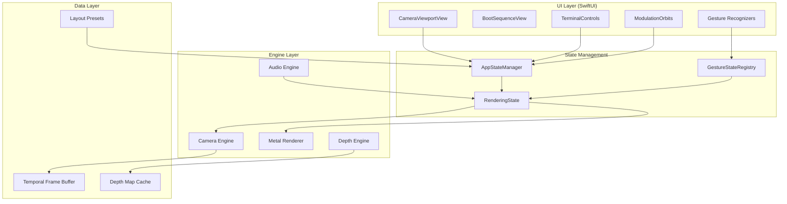
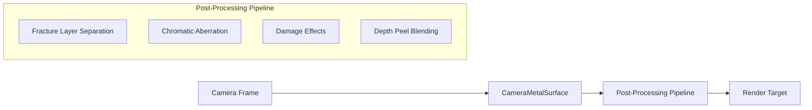

# Technical Design Document

## grey//VISION UI Enhancement Project

**Feature Name:** `greyvision-ui-enhancements`  
**Last Updated:** 2024  
**Status:** Draft - Ready for Review

---

## Overview

This document describes the technical architecture for comprehensive UI enhancements to the grey//VISION iOS native application. The project transforms the existing live visualizer/creative engine into a high-end professional creative instrument with premium cinematic feel and professional creative tool aesthetics.

### Scope

This design covers 9 major feature requirements:

1. **Premium Camera Viewport** - Corner brackets, contextual telemetry, accessible rendering
2. **Asymmetrical Layout Engine** - Intentional artistic layout composition
3. **Cinematic Boot Sequence** - Premium startup with CRT/phosphor aesthetic
4. **Signal Fracture Interaction** - Two-finger gesture for temporal layer separation
5. **Time Scrub Navigation** - Touch-and-hold gesture for history navigation
6. **Depth Peel Visualization** - LiDAR-based spatial layer separation
7. **Modulation Orbits Menu** - Radial parameter modulation controls
8. **Audio Damage Effects** - Sound-based visual distortion
9. **Terminal-Style Control System** - Granular parameter adjustment controls

### Technical Stack

| Layer | Technology | Purpose |
|-------|------------|---------|
| UI Composition | SwiftUI | View hierarchy, gesture detection, state-driven rendering |
| Rendering Pipeline | Metal | GPU-accelerated effects, post-processing, visual distortions |
| Camera Capture | AVFoundation | Camera pipeline, frame acquisition, device management |
| Depth Processing | ARKit/LiDAR | Depth map parsing, layer separation, spatial analysis |
| Audio Analysis | AVAudioEngine | Audio peak detection, distortion modulation |
| Haptics | CoreHaptics | Tactile feedback for gesture interactions |
| Data Persistence | Core Data/UserDefaults | Layout presets, control values, user preferences |

### Design Principles

1. **Modularity** - Each feature operates as an independent module with clear interfaces
2. **Performance-First** - 60fps target with optimized GPU usage and memory management
3. **Accessibility-First** - Reduce Motion, Dynamic Type, VoiceOver support built-in
4. **Creative Control** - Granular parameter adjustment for professional use cases
5. **Cinematic Feel** - Premium animations, transitions, and visual feedback

---

## System Architecture



### Architecture Patterns

1. **State-Driven Rendering** - All UI state flows through centralized state containers
2. **Gesture-Driven Interaction** - Custom gesture recognizers for complex interactions
3. **Metal Post-Processing** - Camera feed rendered through Metal pipeline for effects
4. **Modular Components** - Each feature has dedicated renderer and interpreter components

### Data Flow

```
User Gesture → Gesture Recognizer → State Update → 
Metal Effect Application → Camera Frame Processing → 
Rendered Output
```

---

## Component Breakdown

### 1. CameraViewportEnhancement

**Purpose:** Professional camera viewport with corner brackets and contextual telemetry

**Key Components:**

| Component | Responsibility |
|-----------|----------------|
| CameraViewportView | SwiftUI view container with Metal surface |
| CornerBracketRenderer | Metal/ SwiftUI overlay for corner brackets |
| TelemetryManager | Manages camera status, resolution, frame rate |
| TelemetryView | SwiftUI overlay displaying telemetry data |

**State Structure:**

```swift
struct CameraViewportState {
    var isActive: Bool = false
    var cornerBrackets: CornerBracketConfig = .default
    var telemetry: CameraTelemetryData
    var accessibility: AccessibilitySettings
}
```

**Interfaces:**

```swift
protocol CameraViewportRepresentable {
    func updateCornerBrackets(_ config: CornerBracketConfig)
    func updateTelemetry(_ data: CameraTelemetryData)
    func applyAccessibility(_ settings: AccessibilitySettings)
}
```

**Integration Points:**

- Connects to `CameraController` for live telemetry
- Uses `TemporalFrameBuffer` for frame history access
- Integrates with `AccessibilitySettings` for motion preferences

---

### 2. BootSequence

**Purpose:** Cinematic application startup sequence

**Key Components:**

| Component | Responsibility |
|-----------|----------------|
| BootSequenceManager | Orchestrates boot phases |
| PhosphorBloomEffect | CRT-style gradient effect |
| CRTScanlineOverlay | Scanline reveal animation |
| BootTransition | Final transition to main interface |

**Boot Sequence Flow:**

```
Phase 1: Phosphor Bloom (0-1200ms)
  → Phase 2: CRT Scanline Reveal (1200-1800ms)
    → Phase 3: System Status (1800-2500ms)
      → Phase 4: Main Interface Fade-In (2500-2900ms)
```

**Configuration:**

```swift
struct BootSequenceConfig {
    var durationRange: ClosedRange<TimeInterval> = 2.5...4.0
    var phosphorBloomDuration: TimeInterval = 1.2
    var scanlineDuration: TimeInterval = 0.6
    var statusDuration: TimeInterval = 0.7
    var fadeDuration: TimeInterval = 0.4
    var forceQuickBoot: Bool = false
}
```

**Integration Points:**

- Reads `userForceQuickBoot` environment variable
- Respects `accessibility.reduceMotion` setting
- Applies haptic feedback at sequence end

---

### 3. SignalFractureGesture

**Purpose:** Two-finger pinch-out to reveal temporal layers

**Key Components:**

| Component | Responsibility |
|-----------|----------------|
| SignalFractureGesture | Custom gesture recognizer |
| FractureState | Manages fracture mode lifecycle |
| TemporalLayerRenderer | Renders multiple time-offset frames |
| ChromaticAberrationEffect | Metal post-processing effect |

**Gesture States:**

```
Inactive → Recognizing (pinch gesture detected)
  → Fracturing (scale > 1.0)
    → Fully Fractured (scale > 2.0 with chromatic aberration)
      → Returning (scale → 1.0)
        → Inactive
```

**Time Offset Configuration:**

```swift
struct TemporalLayerOffsets {
    var current: TimeInterval = 0.0       // 0ms
    var recent: TimeInterval = 0.2        // 200ms
    var past: TimeInterval = 0.5          // 500ms
    var maxHistory: TimeInterval = 2.0    // 2000ms
}
```

**Metal Effect Chain:**

```
Camera Frame → Temporal Buffer → Layer Separation → 
Chromatic Aberration (if scale > 2.0) → Render Target
```

**Integration Points:**

- Uses `TemporalFrameBuffer` for frame history access
- Applies Metal effects via `CameraMetalSurface`
- Manages gesture timeouts (auto-exit after 3s inactivity)

---

### 4. TimeScrubGesture

**Purpose:** Touch-and-hold for history navigation

**Key Components:**

| Component | Responsibility |
|-----------|----------------|
| TimeScrubGesture | Custom gesture recognizer |
| TimelineOverlayView | SwiftUI timeline display |
| HistorySeeker | Seeks to specific time position |
| PlaybackController | Manages playback rate |

**Timeline Configuration:**

```swift
struct TimeScrubConfig {
    var historyDuration: TimeInterval = 30.0
    var seekLatency: TimeInterval = 0.05
    var accelerationThreshold: Double = 2.0
    var maxPlaybackRate: Double = 4.0
}
```

**Seek Algorithm:**

```
Gesture Horizontal Position → Normalized [0, 1] → 
Seek Time → Frame Buffer Lookup → Display Frame
```

**Acceleration Logic:**

```swift
func calculatePlaybackRate(scrubSpeed: Double) -> Double {
    guard scrubSpeed > config.accelerationThreshold else { return 1.0 }
    return min(scrubSpeed * 2, config.maxPlaybackRate)
}
```

**Integration Points:**

- Uses `TemporalFrameBuffer` for frame history
- Communicates with `CameraController` for seek operations
- Manages playback rate transitions

---

### 5. DepthPeel

**Purpose:** LiDAR-based layer separation

**Key Components:**

| Component | Responsibility |
|-----------|----------------|
| DepthPeelEngine | Parses depth maps at 30Hz |
| DepthLayerConfig | Layer thresholds and separation |
| DepthPeelRenderer | Renders layers with opacity |
| SyntheticDepthFallback | Uses ML depth estimation when LiDAR unavailable |

**Layer Configuration:**

```swift
struct DepthLayer {
    var name: String
    var minDistance: Float
    var maxDistance: Float
    var horizontalOffset: CGFloat = 5.0
    var opacity: CGFloat = 1.0
    var blendMode: SwiftUI.BlendMode = .normal
}
```

**Default Layers:**

```
Foreground: 0-1m
Midground: 1-3m
Background: 3-5m
Far: 5m+
```

**Confidence Handling:**

```swift
func applyDepthConfidence(_ confidence: Float, pixel: SIMD4<Float>) -> SIMD4<Float> {
    guard confidence < 0.3 else { return pixel }
    return applyGaussianBlur(pixel, sigma: 2.0)
}
```

**Integration Points:**

- Connects to ARKit for LiDAR data
- Falls back to synthetic depth when LiDAR unavailable
- Uses Metal for per-pixel confidence processing

---

### 6. ModulationOrbits

**Purpose:** Radial parameter modulation controls

**Key Components:**

| Component | Responsibility |
|-----------|----------------|
| ModulationOrbitGesture | Circular gesture recognizer |
| OrbitManager | Manages orbit rings and parameters |
| ParameterModifier | Updates target parameters |
| OrbitVisualizer | Renders orbital rings |

**Orbit Configuration:**

```swift
struct ModulationOrbitConfig {
    var minRadius: CGFloat = 50.0
    var maxRadius: CGFloat = 200.0
    var deadzoneRadius: CGFloat = 10.0
    var updateRate: TimeInterval = 1.0 / 60.0
    var maxSimultaneousOrbits: Int = 3
}
```

**Parameter Updates:**

```
Finger Angle → Normalized [0, 1] → Parameter Value → 
Callback (60Hz) → Parameter Update
```

**Multi-Orbit Support:**

```swift
class ModulationOrbitManager {
    var activeOrbits: [OrbitID: ActiveOrbit] = [:]
    
    func addOrbit(for gesture: UIPinchGesture) -> OrbitID?
    func updateOrbit(_ id: OrbitID, with gesture: UIPinchGesture)
    func removeOrbit(_ id: OrbitID)
}
```

**Integration Points:**

- Connects to parameter binding system
- Manages multiple concurrent orbits
- Handles radius clamping at viewport edges

---

### 7. AudioDamage

**Purpose:** Sound-based visual distortion

**Key Components:**

| Component | Responsibility |
|-----------|----------------|
| AudioDamageEngine | Interprets audio levels as damage intensity |
| DamageRenderer | Applies visual distortion effects |
| AudioAnalyzer | Real-time audio peak detection |
| DamageEffectManager | Manages active effects |

**Damage Types:**

```swift
enum DamageEffectType {
    case colorShift(rgbSeparation: CGFloat)
    case pixelation(blockSize: Int)
    case scanlineJitter(intensity: CGFloat)
}
```

**Intensity Calculation:**

```swift
func calculateDamageIntensity(audioPeak: Float) -> CGFloat {
    let normalized = min(max(audioPeak, 0.0), 1.0)
    return CGFloat(normalized)
}
```

**RGB Separation Configuration:**

```swift
struct RGBSeparationEffect {
    var maxOffset: CGFloat = 8.0
    
    func calculateOffsets(intensity: CGFloat) -> (r: CGPoint, g: CGPoint, b: CGPoint) {
        let offset = maxOffset * intensity
        return (
            r: CGPoint(x: offset, y: 0),
            g: CGPoint(x: 0, y: offset),
            b: CGPoint(x: -offset, y: -offset)
        )
    }
}
```

**Integration Points:**

- Connects to `AVAudioEngine` for audio analysis
- Uses Metal for post-processing effects
- Manages fade-out on audio level drop

---

### 8. TerminalControlSystem

**Purpose:** Terminal-inspired granular parameter controls

**Key Components:**

| Component | Responsibility |
|-----------|----------------|
| TerminalSlider | Slider control with high precision |
| ParameterEditor | Terminal-style parameter editor |
| ControlRenderer | Renders controls with numeric overlays |
| ModifierDetector | Detects modifier key combinations |

**Slider Configuration:**

```swift
struct SliderConfig {
    var minRange: Double = 0.0
    var maxRange: Double = 1000.0
    var stepCount: Int = 1001  // 1000+ discrete steps
    var valuePrecision: Int = 2  // 0.01 precision
    var maxUpdateRate: TimeInterval = 1.0 / 60.0
}
```

**Precision Modifiers:**

```swift
func calculateStepSize(baseStep: Double, modifierActive: Bool) -> Double {
    return modifierActive ? baseStep / 10.0 : baseStep
}
```

**Interaction Methods:**

```swift
enum SliderInteraction {
    case clickToSet(targetValue: Double)
    case drag(startValue: Double, currentDelta: Double)
    case scrollWheel(delta: Double)
}
```

**Integration Points:**

- Connects to parameter binding system
- Manages value animations on preset load
- Shows confirmation overlay for large value changes

---

### 9. AsymmetricalLayoutEngine

**Purpose:** Intentional artistic layout composition

**Key Components:**

| Component | Responsibility |
|-----------|----------------|
| LayoutEngine | Main layout calculation engine |
| LayoutPreset | Predefined asymmetrical layouts |
| LayoutEngineViewModifier | SwiftUI view modifier for layout |
| LayoutPersistence | Persists user-defined layouts |

**Layout Presets:**

```
1. Default Asymmetrical
   - 60/40 split with large viewport
   - Bottom-right control panel

2. Cinematic Focus
   - 80/20 split with large viewport
   - Bottom control bar

3. Control-Centric
   - 40/60 split with control dominance
   - Side-by-side layout
```

**Layout Calculation:**

```swift
func calculateViewportArea(
    screenBounds: CGRect,
    dockedPanels: [PanelLayout]
) -> CGRect {
    // Start with full screen
    var viewport = screenBounds
    
    // Subtract docked panel areas
    for panel in dockedPanels {
        viewport = viewport.intersection(panel.frame.inverted)
    }
    
    return viewport
}
```

**Spring Animation:**

```swift
let springParams =UISpringTimingParameters(
    dampingRatio: 0.7,
    initialVelocity: .zero
)
```

**Integration Points:**

- Works with SwiftUI layout system
- Manages panel z-index conflicts
- Persists user layouts to Core Data

---

## Data Models

### Gesture State Models

```swift
enum FractureMode: Equatable {
    case inactive
    case recognizing
    case fracturing(scale: CGFloat)
    case fullyFractured(scale: CGFloat)
    case returning
}

enum TimeScrubMode: Equatable {
    case inactive
    case waiting(duration: TimeInterval)
    case active(seekTime: TimeInterval, playbackRate: Double)
    case ended
}

enum DamageMode: Equatable {
    case inactive
    case active(intensity: CGFloat)
    case fadingOut(intensity: CGFloat)
}
```

### Frame History Models

```swift
struct TemporalFrame {
    var timestamp: TimeInterval
    var pixelBuffer: CVPixelBuffer
    var cameraConfig: CameraConfiguration
}

struct FrameHistoryBuffer {
    var frames: [TemporalFrame] = []
    var maxDuration: TimeInterval
    var capacity: Int
    
    mutating func addFrame(_ frame: TemporalFrame)
    func frameAtTime(_ time: TimeInterval) -> TemporalFrame?
    func removeOldFrames(upTo time: TimeInterval)
}
```

### Telemetry Data Models

```swift
struct CameraTelemetryData: Equatable {
    var isRecording: Bool
    var resolution: CGSize
    var frameRate: Double
    var zoomLevel: CGFloat
    var exposureCompensation: CGFloat
    var iso: Double
    var shutterSpeed: Double
    var lensPosition: CGFloat
}

struct SystemTelemetryData: Equatable {
    var gpuUtilization: CGFloat
    var cpuUtilization: CGFloat
    var memoryUsage: CGFloat
    var frameDrops: Int
}
```

### Layout Models

```swift
struct PanelLayout: Codable, Equatable {
    var id: String
    var frame: CGRect
    var zOrder: Int
    var isDocked: Bool
    var isHidden: Bool
}

struct LayoutPreset: Codable {
    var name: String
    var panels: [PanelLayout]
    var viewportArea: CGRect
}
```

---

## State Management

### AppStateContainer

```swift
@MainActor
final class AppStateContainer: ObservableObject {
    // Camera Viewport State
    @Published var cameraViewport: CameraViewportState
    @Published var cameraTelemetry: CameraTelemetryData
    
    // Boot Sequence State
    @Published var bootSequence: BootSequenceState
    
    // Gesture States
    @Published var fractureMode: FractureMode
    @Published var timeScrubMode: TimeScrubMode
    @Published var damageMode: DamageMode
    
    // Rendering State
    @Published var renderingState: RenderingState
    
    // Layout State
    @Published var activeLayout: LayoutPreset
    @Published var availableLayouts: [LayoutPreset]
    
    // Terminal Controls
    @Published var activeParameter: String?
    @Published var parameterValues: [String: Double]
    
    // Audio State
    @Published var audioPeak: Float = 0.0
    
    // Accessibility
    @Published var accessibility: AccessibilitySettings
    
    // Methods
    func updateCameraTelemetry(_ telemetry: CameraTelemetryData)
    func enterFractureMode(scale: CGFloat)
    func exitFractureMode()
    func beginTimeScrub()
    func endTimeScrub()
    func applyDamage(intensity: CGFloat)
    func updateLayout(_ layout: LayoutPreset)
    func updateParameterValue(_ value: Double, for parameter: String)
}
```

### State Update Flow

```
User Interaction → Gesture Recognizer → State Update → 
State Propagation → Metal Effect Application → 
Camera Frame Processing → Rendered Output
```

### Threading Model

- **Main Actor** - All UI state updates
- **Metal Command Queue** - GPU operations
- **Capture Session Queue** - Camera frame processing
- **Audio Engine Queue** - Audio analysis

---

## Rendering Pipeline

### Metal Pipeline Overview



### Camera Rendering Pipeline

```
1. Camera Frame Acquisition (AVCaptureSession)
   ↓
2. Metal Texture Creation (CVPixelBuffer → MTLTexture)
   ↓
3. Post-Processing Pass
   - Fracture layer separation (if active)
   - Chromatic aberration (if fracture scale > 2.0)
   - Damage effects (if audio peak > threshold)
   - Depth peel blending (if LiDAR available)
   ↓
4. Render to MTLTexture
   ↓
5. SwiftUI Overlay Composition
   - Corner brackets
   - Telemetry
   - Timeline (time scrub)
   - Modulation orbits
   ↓
6. Final Display Output
```

### Metal Shader Integration

```swift
// Example: Chromatic Aberration Shader
static let chromaticAberrationPipelineState: MTLRenderPipelineState = {
    let library = device.makeLibrary(source: shaderSource, options: [])!
    let fragmentFunction = library.makeFunction(name: "chromaticAberrationFragment")
    
    let pipelineDescriptor = MTLRenderPipelineDescriptor()
    pipelineDescriptor.colorAttachments[0].pixelFormat = .bgra8Unorm
    pipelineDescriptor.fragmentFunction = fragmentFunction
    
    return try! device.makeRenderPipelineState(descriptor: pipelineDescriptor)
}()

// Fragment function
fragment float4 chromaticAberrationFragment(
    VertexOut vertexIn [[stage_in]],
    texture2d<float> colorTexture [[texture(0)]]
) {
    constexpr float maxOffset = 8.0;
    float offset = maxOffset * u_damageIntensity;
    
    float r = colorTexture.sample(sampler, vertexIn.texcoord + float2(offset, 0.0)).r;
    float g = colorTexture.sample(sampler, vertexIn.texcoord + float2(0.0, offset)).g;
    float b = colorTexture.sample(sampler, vertexIn.texcoord + float2(-offset, -offset)).b;
    
    return float4(r, g, b, 1.0);
}
```

### Frame Processing Chain

```swift
class FrameProcessor {
    let device: MTLDevice
    let commandQueue: MTLCommandQueue
    
    func processFrame(
        _ pixelBuffer: CVPixelBuffer,
        with effects: EffectChain
    ) -> MTLTexture {
        let texture = textureFromPixelBuffer(pixelBuffer)
        
        let commandBuffer = commandQueue.makeCommandBuffer()
        let renderPass = MTLRenderPassDescriptor()
        
        // Apply effects in order
        for effect in effects.chain {
            applyEffect(effect, texture: texture, commandBuffer: commandBuffer)
        }
        
        commandBuffer.commit()
        commandBuffer.waitUntilCompleted()
        
        return renderPass.outputTexture
    }
}
```

---

## Animation System

### Animation Configuration

```swift
struct AnimationConfiguration {
    var cornerBracketFadeIn: CAMediaTimingFunction = .easeOut(duration: 0.3)
    var bootPhosphorBloom: CAMediaTimingFunction = .easeOut(duration: 1.2)
    var bootScanline: CAMediaTimingFunction = .linear(duration: 0.6)
    var fractureReturn: CAMediaTimingFunction = .spring(damping: 0.7, duration: 0.3)
    var timeScrubSeek: CAMediaTimingFunction = .linear
    var damageFadeOut: CAMediaTimingFunction = .easeOut(duration: 0.5)
    var layoutTransition: CAMediaTimingFunction = .spring(damping: 0.7, stiffness: 400)
    var sliderAnimation: CAMediaTimingFunction = .spring(damping: 0.6, stiffness: 500)
}
```

### Spring Physics Parameters

```swift
struct SpringParameters {
    var dampingRatio: CGFloat = 0.7
    var stiffness: CGFloat = 400.0
    var velocity: CGFloat = 0.0
    var mass: CGFloat = 1.0
}

// Layout transition
let layoutSpring = SpringParameters(
    dampingRatio: 0.7,
    stiffness: 400.0
)

// Slider interaction
let sliderSpring = SpringParameters(
    dampingRatio: 0.6,
    stiffness: 500.0
)

// Fracture return
let fractureSpring = SpringParameters(
    dampingRatio: 0.7,
    stiffness: 300.0
)
```

### Motion Scale Configuration

```swift
struct MotionScale {
    var minimum: CGFloat = 0.1
    var normal: CGFloat = 1.0
    var emphasized: CGFloat = 1.5
    var maximum: CGFloat = 2.0
}

// Usage
let emphasizedMotion = MotionScale.emphasized
let normalMotion = MotionScale.normal
```

### Animation Timing

```swift
enum AnimationTiming {
    case immediate
    case fast(duration: TimeInterval = 0.15)
    case normal(duration: TimeInterval = 0.3)
    case slow(duration: TimeInterval = 0.5)
    case custom(duration: TimeInterval, timingFunction: CAMediaTimingFunction)
}

// Example animations
let cornerBracketFade = AnimationTiming.fast(duration: 0.3)
let bootSequenceFade = AnimationTiming.normal(duration: 0.4)
let fractureEffect = AnimationTiming.custom(
    duration: 0.3,
    timingFunction: .easeOutBack
)
```

---

## Accessibility Considerations

### Reduce Motion Handling

```swift
struct AccessibilitySettings {
    var reduceMotion: Bool
    var preferCrossFadeTransitions: Bool
    var displayZoom: CGFloat
    var fontSizeScale: CGFloat
}

@MainActor
func accessibilitySettings() -> AccessibilitySettings {
    let userInterface = UIUserInterfaceStyle()
    let reduceMotion = UIAccessibility.isReduceMotionEnabled
    let preferCrossFade = UIAccessibility.isCrossFadeTransitionsEnabled
    let displayZoom = UIScreen.main.scale
    let fontSizeScale = UIAccessibility.preferredFontScale
    
    return AccessibilitySettings(
        reduceMotion: reduceMotion,
        preferCrossFadeTransitions: preferCrossFade,
        displayZoom: displayZoom,
        fontSizeScale: fontSizeScale
    )
}
```

### Motion-Sensitive Features

| Feature | Normal Behavior | Reduced Motion Behavior |
|---------|----------------|----------------------|
| Corner Brackets | Fade in over 300ms | Instant appearance |
| Boot Sequence | 4-second animated sequence | 1.5s static CRT scanlines |
| Layout Transitions | Spring physics animation | Immediate update |
| Slider Updates | Smooth interpolation | Immediate update |
| Fracture Return | Smooth interpolation | Immediate return |

### Dynamic Type Support

```swift
extension Typography {
    static let controlLabel = UIFont.preferredFont(for: .caption2, weight: .medium)
    static let controlValue = UIFont.preferredFont(for: .body, weight: .bold)
    static let telemetry = UIFont.preferredFont(for: .caption1, weight: .regular)
}
```

### VoiceOver Support

```swift
extension CameraViewportView {
    var accessibilityElement: AccessibilityElement {
        AccessibilityElement(
            label: "Camera Viewport",
            value: "Live",
            actions: [
                AccessibilityAction(name: "Start Recording") { /* */ },
                AccessibilityAction(name: "Stop Recording") { /* */ }
            ]
        )
    }
}
```

### High Contrast Mode

```swift
extension Color {
    static func highContrast(for base: Color, in mode: UIUserInterfaceStyle) -> Color {
        switch mode {
        case .light:
            return base.isLight ? .black : base
        case .dark:
            return base.isDark ? .white : base
        @unknown default:
            return base
        }
    }
}
```

---

## Performance Considerations

### Frame Budget

```swift
struct FrameBudget {
    static let targetFrameTime: TimeInterval = 1.0 / 60.0  // 16.67ms
    static let gpuBudget: TimeInterval = 8.0 / 60.0        // 8ms for GPU
    static let cpuBudget: TimeInterval = 8.0 / 60.0        // 8ms for CPU
    static let renderBudget: TimeInterval = 0.67 / 60.0    // 0.67ms for rendering overhead
}
```

### Memory Management

```swift
class TemporalFrameBuffer {
    private let maxFrames: Int = 180  // 6 seconds at 30fps
    private let maxMemoryMB: Int = 500
    
    func shouldEvictFrames() -> Bool {
        let currentMemory = calculateCurrentMemoryUsage()
        return currentMemory > maxMemoryMB
    }
    
    func evictOldestFrames() {
        while shouldEvictFrames() && !frames.isEmpty {
            frames.removeFirst()
        }
    }
}
```

### GPU Optimization

```swift
struct GPUOptimization {
    // Texture atlasing for multiple layers
    static let textureAtlasSize: CGSize = CGSize(width: 2048, height: 2048)
    
    // Mipmapping for downsampled rendering
    static let usesMipmapping: Bool = true
    
    // Texture compression
    static let textureFormat: MTLPixelFormat = .bgra8Unorm_sRGB
    
    // Render pass optimizations
    static let usesDepthStencil: Bool = false
    static let colorStoreAction: MTLStoreAction = .store
}
```

### Metal Rendering Optimization

```swift
class MetalRenderer {
    func optimizeRenderPass(for effects: [Effect]) {
        // Batch similar effects
        let batchedEffects = groupEffectsByType(effects)
        
        // Use texture atlasing for layer separation
        if batchedEffects.contains(.fracture) {
            useTextureAtlasing()
        }
        
        // Reuse pipeline states
        useCachedPipelineStates()
        
        // Minimize render target switches
        minimizeRenderTargetSwitches()
    }
}
```

### Frame Drop Detection

```swift
class FrameDropper {
    private var frameTimes: [TimeInterval] = []
    private let threshold: Double = 2.0  // 2x target frame time
    
    func recordFrameTime(_ time: TimeInterval) {
        frameTimes.append(time)
        if frameTimes.count > 100 {
            frameTimes.removeFirst()
        }
    }
    
    func shouldDropFrame() -> Bool {
        guard frameTimes.count > 10 else { return false }
        
        let averageTime = frameTimes.average()
        return averageTime > threshold * (1.0 / 60.0)
    }
}
```

### Power Optimization

```swift
struct PowerOptimization {
    static var lowPowerModeEnabled: Bool {
        NSProcessInfo.processInfo.isLowPowerModeEnabled
    }
    
    static func adjustForLowPower() {
        // Reduce frame buffer size
        TemporalFrameBuffer.shared.setMaxFrames(90)  // 3 seconds
        
        // Reduce texture resolution
        TextureCache.shared.setMaxResolution(1024)
        
        // Reduce effect complexity
        EffectChain.shared.setSimplifiedMode()
    }
}
```

---

## Testing Strategy

### Unit Tests

```swift
class CameraViewportTests: XCTestCase {
    func testCornerBracketConfiguration() {
        // Round trip: configure → read back → match
        let config = CornerBracketConfig(color: .red, thickness: 2.0)
        
        let viewport = CameraViewport()
        viewport.configureCornerBrackets(config)
        
        let readConfig = viewport.readCornerBracketConfig()
        XCTAssertEqual(readConfig.color, config.color)
        XCTAssertEqual(readConfig.thickness, config.thickness)
    }
    
    func testTelemetryUpdatePerformance() {
        let viewport = CameraViewport()
        
        measure {
            for _ in 0..<100 {
                viewport.updateTelemetry(generateRandomTelemetry())
            }
        }
    }
}

class TimeScrubTests: XCTestCase {
    func testSeekRoundTrip() {
        // Round trip: seek to T → return to live → seek to T again
        let buffer = TemporalFrameBuffer(historyDuration: 30.0)
        
        let timeT: TimeInterval = 15.0
        let frameT = buffer.frameAtTime(timeT)!
        
        buffer.seek(to: timeT)
        buffer.returnToLive()
        buffer.seek(to: timeT)
        
        let frameTAgain = buffer.frameAtTime(timeT)!
        XCTAssertEqual(frameT.timestamp, frameTAgain.timestamp)
    }
}
```

### Integration Tests

```swift
class SignalFractureIntegrationTests: XCTestCase {
    func testFractureModeLifecycle() {
        let gesture = SignalFractureGesture()
        let renderer = SignalFractureRenderer()
        
        gesture.simulatePinchOut()
        XCTAssertEqual(renderer.mode, .fracturing)
        
        gesture.simulatePinchOut(scale: 2.5)
        XCTAssertEqual(renderer.mode, .fullyFractured)
        
        gesture.simulatePinchIn()
        XCTAssertEqual(renderer.mode, .returning)
        
        gesture.simulateEnded()
        XCTAssertEqual(renderer.mode, .inactive)
    }
}
```

### Performance Tests

```swift
class PerformanceTests: XCTestCase {
    func testCameraViewport60FPS() {
        let viewport = CameraViewport()
        viewport.activate()
        
        measureMetrics([.wallClockTime], automaticallyStartMeasuring: false) {
            startMeasuring()
            for _ in 0..<60 {  // 1 second at 60fps
                viewport.renderFrame()
            }
            stopMeasuring()
        }
    }
    
    func testTemporalFrameBufferMemory() {
        let buffer = TemporalFrameBuffer()
        
        measure {
            for i in 0..<180 {
                buffer.addFrame(generateFrame(at: TimeInterval(i) / 30.0))
            }
        }
    }
}
```

---

## Implementation Tasks

### Phase 1: Core Infrastructure

1. **State Management Setup**
   - Create `AppStateContainer`
   - Implement gesture state registry
   - Set up rendering state

2. **Metal Rendering Pipeline**
   - Configure `CameraMetalSurface`
   - Implement post-processing effects
   - Create effect chain system

3. **Gesture Recognizers**
   - Implement `SignalFractureGesture`
   - Implement `TimeScrubGesture`
   - Implement `ModulationOrbitGesture`

### Phase 2: Feature Implementation

4. **Camera Viewport Enhancement**
   - Implement corner brackets
   - Implement telemetry display
   - Add accessibility support

5. **Boot Sequence**
   - Implement phosphor bloom
   - Implement CRT scanline reveal
   - Add quick boot support

6. **Signal Fracture**
   - Implement temporal layer separation
   - Add chromatic aberration effect
   - Handle gesture lifecycle

7. **Time Scrub**
   - Implement timeline overlay
   - Add seek functionality
   - Implement acceleration

8. **Depth Peel**
   - Implement LiDAR depth parsing
   - Add layer separation rendering
   - Handle fallback for non-LiDAR devices

9. **Modulation Orbits**
   - Implement orbital rings
   - Add parameter modulation
   - Support multi-orbit

10. **Audio Damage**
    - Implement audio analysis
    - Add distortion effects
    - Handle fade-out

11. **Terminal Controls**
    - Implement high-precision slider
    - Add parameter editor
    - Support modifier keys

12. **Layout Engine**
    - Implement layout calculations
    - Add preset system
    - Implement persistence

### Phase 3: Polish

13. **Animation System**
    - Configure timing functions
    - Implement spring physics
    - Add motion scales

14. **Accessibility**
    - Implement reduce motion support
    - Add VoiceOver support
    - Implement high contrast

15. **Performance Optimization**
    - Profile and optimize Metal rendering
    - Implement frame drop detection
    - Add memory management

### Phase 4: Testing

16. **Unit Tests**
    - Implement state management tests
    - Add gesture recognition tests
    - Add rendering tests

17. **Integration Tests**
    - Test full gesture flows
    - Test rendering pipeline
    - Test accessibility features

18. **Performance Tests**
    - Measure 60fps target
    - Test memory usage
    - Profile GPU usage

---

## Design Review Checklist

- [ ] All 9 feature requirements addressed
- [ ] System architecture documented
- [ ] Component interfaces defined
- [ ] Data models comprehensive
- [ ] State management strategy clear
- [ ] Metal rendering pipeline documented
- [ ] Animation system configured
- [ ] Accessibility considerations included
- [ ] Performance considerations addressed
- [ ] Testing strategy defined
- [ ] Implementation tasks broken down
